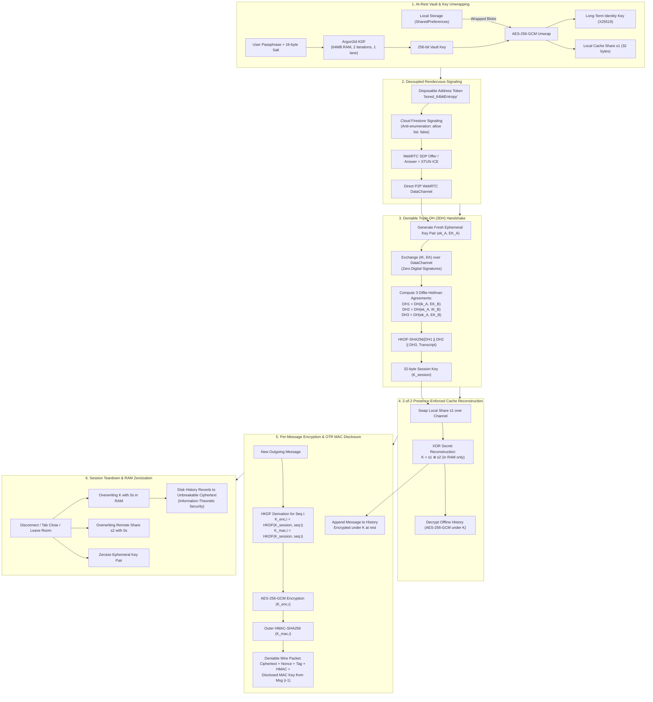

# 🔒 Deniable P2P Web Chat (Triple-DH + 2-of-2 Presence-Enforced Cache)

A private peer-to-peer web chat built with **Flutter Web**, **WebRTC DataChannels**, **Cloud Firestore** signaling, and an advanced cryptographic architecture featuring **Deniable Triple-DH (3DH)**, **OTR-style MAC key disclosure**, and a **2-of-2 secret-split cache** protected at rest with **Argon2id**.

---

## 📊 Security & Encryption Architecture

### 1. End-to-End Cryptographic Lifecycle
> Source file: [`docs/encryption_and_security_lifecycle.mmd`](docs/encryption_and_security_lifecycle.mmd)



### 2. Live P2P Handshake & OTR Repudiation Sequence
> Source file: [`docs/p2p_handshake_and_otr_sequence.mmd`](docs/p2p_handshake_and_otr_sequence.mmd)

```mermaid
sequenceDiagram
    autonumber
    participant Alice as Alice (Initiator)
    participant Firestore as Firestore Signaling
    participant Bob as Bob (Responder)

    Note over Alice, Bob: 1. Passphrase Vault Unlock
    Alice->>Alice: Argon2id unwrap: Local Identity IK_A & Share s1
    Bob->>Bob: Argon2id unwrap: Local Identity IK_B & Share s2

    Note over Alice, Firestore: 2. Decoupled Rendezvous
    Alice->>Firestore: Post SDP Offer & ICE to Bob's disposable alias
    Firestore->>Bob: Incoming call detected on address
    Bob->>Firestore: Post SDP Answer & ICE candidates
    Alice->>Bob: Direct WebRTC RTCDataChannel opened (bypass Firestore)

    Note over Alice, Bob: 3. Deniable Triple-DH (3DH)
    Alice->>Bob: 3DH_HANDSHAKE: { IK_A, EK_A } (No signatures!)
    Bob->>Alice: 3DH_HANDSHAKE: { IK_B, EK_B } (No signatures!)
    Alice->>Alice: K_session = HKDF(DH(ik_A,EK_B) || DH(ek_A,IK_B) || DH(ek_A,EK_B))
    Bob->>Bob: K_session = HKDF(DH(ek_B,IK_A) || DH(ik_B,EK_A) || DH(ek_B,EK_A))

    Note over Alice, Bob: 4. 2-of-2 Presence Activation
    Alice->>Bob: SHARE_SWAP: s1
    Bob->>Alice: SHARE_SWAP: s2
    Alice->>Alice: Reconstruct K = s1 ⊕ s2 in RAM (Decrypt past history)
    Bob->>Bob: Reconstruct K = s1 ⊕ s2 in RAM (Decrypt past history)

    Note over Alice, Bob: 5. Message Exchange & OTR MAC Publication
    Alice->>Bob: DENIABLE_MSG #1 (Encrypted with K_enc,1, Authenticated with K_mac,1)
    Bob->>Bob: Verify HMAC(K_mac,1) & Decrypt AES-GCM
    Alice->>Bob: DENIABLE_MSG #2 (Encrypted with K_enc,2; Discloses K_mac,1)
    Note over Alice, Bob: Universal Repudiation: Anyone can now forge Message #1 with K_mac,1

    Note over Alice, Bob: 6. Disconnect & RAM Zeroization
    Alice->>Alice: fillRange(0) over K and s2; drop ephemeral keys
    Bob->>Bob: fillRange(0) over K and s1; drop ephemeral keys
```

---

## 🛡️ Cryptographic Architecture

### 1. 2-of-2 Secret Split Cache Key ($K = s_1 \oplus s_2$)
- History on disk is encrypted under master cache key $K$.
- $K$ is split via XOR secret sharing: $K = s_1 \oplus s_2$.
- User A stores **only** share $s_1$; User B stores **only** share $s_2$.
- **Information-Theoretic Security**: Given only $s_1$, every possible 256-bit key $K$ is equally likely. A seized offline device contains **zero information** about past chat history.
- **Active Presence Enforcement**: Only when both peers are simultaneously online, authenticated via 3DH, and exchange shares across WebRTC does $K$ get reconstructed in RAM.
- **Zeroization**: When a session closes or tab unloads, $K$, $s_2$, and ephemeral keys are immediately overwritten with zeros in RAM.

### 2. At-Rest Protection (Argon2id)
- Each local share $s_1$ and long-term X25519 identity key are wrapped at rest using **AES-256-GCM**.
- The vault key is derived from a user passphrase using **Argon2id** (64MB memory, 2 iterations, 1 lane, 16-byte random salt).

### 3. Cryptographic Deniability (Triple-DH Handshake)
- **Zero Long-Term Signatures**: No Ed25519 or ECDSA signatures are ever generated. Signatures provide non-repudiation (transferable proof of participation to third parties).
- **Mutual Authentication via 3DH**:
  $$DH_1 = DH(ik_A, EK_B)$$
  $$DH_2 = DH(ek_A, IK_B)$$
  $$DH_3 = DH(ek_A, EK_B)$$
  $$K_{\text{session}} = \text{HKDF}(DH_1 \mathbin{\Vert} DH_2 \mathbin{\Vert} DH_3 \mathbin{\Vert} \text{Transcript})$$
- Because either participant could simulate the entire transcript alone using their own private key and the peer's public key, the transcript cannot serve as evidence to an external third party.

### 4. OTR-Style MAC Key Disclosure (Universal Repudiation)
- Every message is authenticated with a symmetric HMAC key: $K_{\text{mac}, i}$.
- In subsequent packet $i+1$, the sender **discloses** $K_{\text{mac}, i}$ on the wire.
- Once $K_{\text{mac}, i}$ is published, **anyone on the Internet** can construct forged messages with valid HMAC tags, establishing universal repudiation.

### 5. Disposable Rendezvous Addresses (Alias Decoupling)
- **Zero Identity Linkage**: Users can generate multiple disposable addresses (e.g. `bored_8f3a-9e1c-b4d2-e7a1`). Addresses are random 64-bit entropy tokens completely decoupled from the user's master X25519 identity key or user ID.
- **Multiple Aliases**: Users can maintain separate addresses for different contacts (e.g. "Work", "Anon", "Friend"). Counterparties cannot correlate that two addresses belong to the same person.
- **Burner / One-Time Mode**: Addresses can be flagged as "Burn after 1 chat", automatically burning from storage and Firestore as soon as the session establishes.
- **QR Code Sharing**: Integrated QR codes allow instant in-person or screen scanning.

### 6. Zero Corroborating Metadata
- No server timestamps, no delivery receipts, and no account IDs in Firestore. Only unauthenticated local client timestamps.

---

## 🚀 Running the Web App

### Run with Brave / Chrome:
```powershell
cd E:\bored
flutter run -d chrome
```

### Or Serve the Production Web Build:
```powershell
cd E:\bored
python -m http.server 8080 -d build/web
```
Open **`http://localhost:8080`** in two browser tabs (or one normal tab + one private window) to test the 2-of-2 presence handshake and live chat side-by-side!

---

## 🧪 Running Unit Tests

Run the full automated test suite verifying Triple-DH math, Argon2id wrapping, 2-of-2 secret reconstruction, and OTR MAC disclosure:
```powershell
flutter test test/deniable_presence_test.dart
```

---

## 📁 Codebase Layout

```
lib/
├── crypto/
│   ├── triple_dh.dart                  # Deniable Triple-DH (3DH) over X25519
│   ├── split_vault.dart                # 2-of-2 secret sharing & Argon2id key wrapping
│   ├── deniable_cipher.dart            # AES-256-GCM + OTR-style MAC disclosure
│   └── diffie_hellman.dart             # Pure Dart RFC 3526 2048-bit MODP DH
├── services/
│   ├── signaling_service.dart          # Firestore SDP Offer/Answer & ICE exchange
│   ├── presence_history_store.dart     # Argon2id encrypted at-rest storage
│   ├── p2p_chat_service.dart           # Session state machine & memory zeroization
│   └── user_address.dart               # Disposable rendezvous alias model
├── screens/
│   ├── home_screen.dart                # Argon2id vault unlock & room creation UI
│   └── chat_screen.dart                # Live deniable chat UI with presence indicators
├── widgets/
│   └── deniable_packet_inspector.dart  # Disclosed MAC key log & presence inspector
├── firebase_options.dart               # Live config for murmur-b7430
└── main.dart                           # Web application entry point

docs/
├── encryption_and_security_lifecycle.mmd # Standalone lifecycle flowchart
└── p2p_handshake_and_otr_sequence.mmd    # Standalone sequence diagram
```
