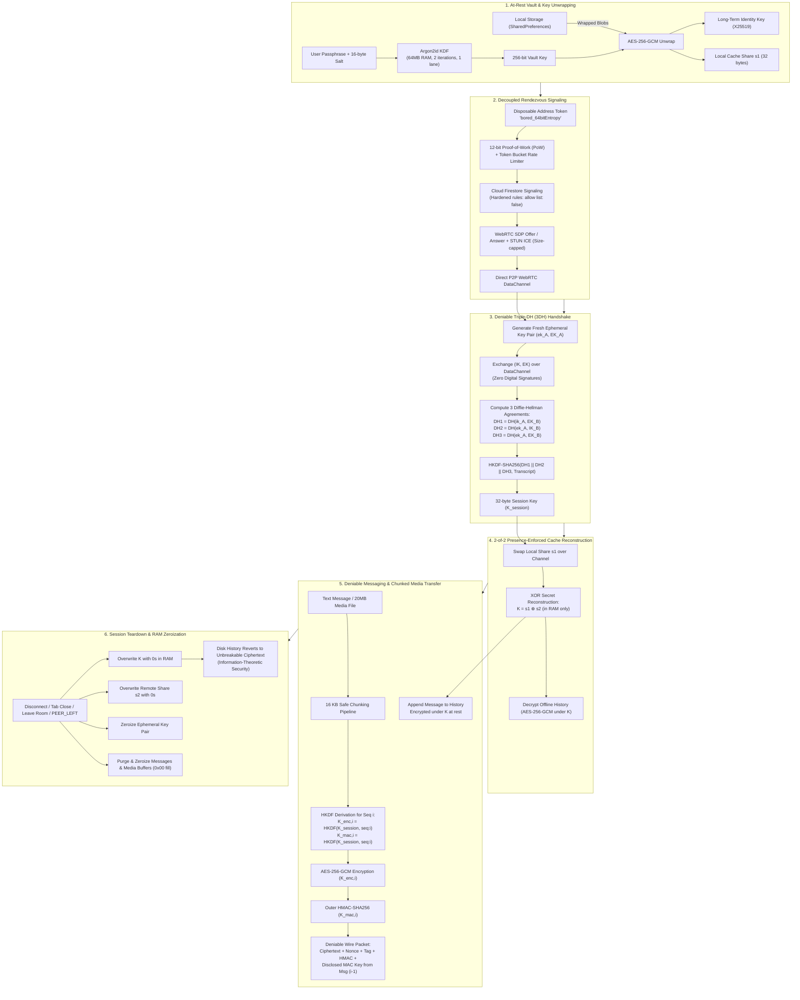
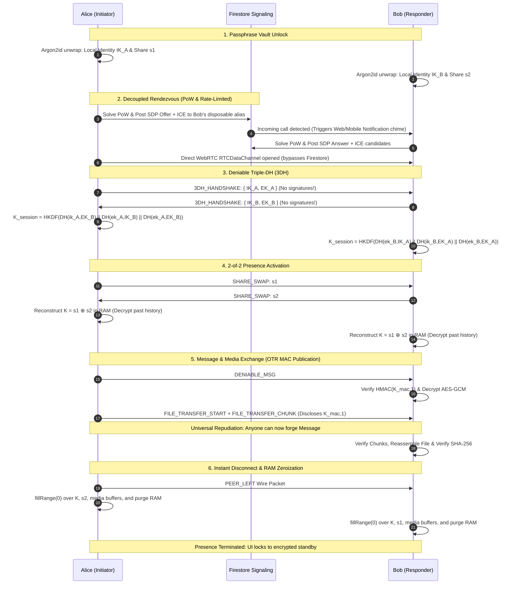

# 🔒 Deniable P2P Web Chat (Triple-DH + 2-of-2 Presence-Enforced Cache)

A private peer-to-peer web chat built with **Flutter Web**, **WebRTC DataChannels**, **Cloud Firestore** signaling, and an advanced cryptographic architecture featuring **Deniable Triple-DH (3DH)**, **OTR-style MAC key disclosure**, an **ephemeral encrypted media transfer pipeline**, and a **2-of-2 secret-split cache** protected at rest with **Argon2id**.

---

## 📊 Security & Encryption Architecture

### 1. End-to-End Cryptographic Lifecycle
> Source file: [`docs/encryption_and_security_lifecycle.mmd`](docs/encryption_and_security_lifecycle.mmd)



### 2. Live P2P Handshake & OTR Repudiation Sequence
> Source file: [`docs/p2p_handshake_and_otr_sequence.mmd`](docs/p2p_handshake_and_otr_sequence.mmd)



---

## 🛡️ Core Cryptographic & Security Mechanisms

### 1. 2-of-2 Secret Split Cache Key ($K = s_1 \oplus s_2$)
- Chat history on disk is encrypted under the master cache key $K$.
- $K$ is split via XOR secret sharing: $K = s_1 \oplus s_2$.
- User A stores **only** share $s_1$; User B stores **only** share $s_2$.
- **Information-Theoretic Security**: Given only $s_1$, every possible 256-bit key $K$ is equally likely. A seized offline device contains **zero mathematical information** about past chat history.
- **Active Presence Enforcement**: Only when both peers are simultaneously online, authenticated via 3DH, and exchange shares across WebRTC does $K$ get reconstructed in RAM.

### 2. At-Rest Protection (Argon2id)
- Each local share $s_1$ and long-term X25519 identity key are wrapped at rest using **AES-256-GCM**.
- The vault key is derived from a user passphrase using **Argon2id** (64MB memory, 2 iterations, 1 lane, 16-byte random salt).

### 3. Cryptographic Deniability (Triple-DH Handshake)
- **Zero Long-Term Signatures**: No Ed25519 or ECDSA signatures are ever generated. Digital signatures provide non-repudiation (transferable proof of participation to third parties).
- **Mutual Authentication via 3DH**:
  $$DH_1 = DH(ik_A, EK_B)$$
  $$DH_2 = DH(ek_A, IK_B)$$
  $$DH_3 = DH(ek_A, EK_B)$$
  $$K_{\text{session}} = \text{HKDF}(DH_1 \mathbin{\Vert} DH_2 \mathbin{\Vert} DH_3 \mathbin{\Vert} \text{Transcript})$$
- Because either participant could simulate the entire transcript alone using their own private key and the peer's public key, the transcript cannot serve as evidence to an external third party.

### 4. OTR-Style MAC Key Disclosure (Universal Repudiation)
- Every message and media packet is authenticated with a symmetric HMAC key: $K_{\text{mac}, i}$.
- In subsequent packet $i+1$, the sender **discloses** $K_{\text{mac}, i}$ on the wire.
- Once $K_{\text{mac}, i}$ is published, **anyone on the Internet** can construct forged messages with valid HMAC tags, establishing universal mathematical repudiation.

### 5. Encrypted P2P Media & File Transfer (Over RTCDataChannel)
- **Direct P2P Streaming**: Files, documents, and images (up to 20 MB) are streamed directly peer-to-peer over WebRTC `RTCDataChannel` without intermediary servers or cloud storage.
- **16 KB Safe Chunking**: Files are partitioned into 16 KB frames (`FILE_TRANSFER_START`, `FILE_TRANSFER_CHUNK`, `FILE_TRANSFER_COMPLETE`) with transmission yielding to maintain browser channel buffer stability.
- **AES-256-GCM + SHA-256 Verification**: Every chunk is individually encrypted under the active session key with HMAC authentication. Full payloads are verified against original SHA-256 digests prior to delivery.
- **Ephemeral RAM & Active Zeroization**: Decrypted image and document bytes exist **strictly in volatile application RAM**. If a peer leaves or closes the tab, all media buffers are explicitly overwritten with `0x00` pattern bytes.
- **Clinical UI**:
  - Attachment menu supporting images (PNG, JPG, WebP, GIF) and documents/binaries (PDF, TXT, ZIP).
  - Real-time chunk transfer progress indicators (0% to 100%).
  - Inline image thumbnails with an **Interactive Lightbox Viewer** (zoom, pan, SHA-256 inspection).
  - One-click file downloading via cross-platform Blob object URL anchors.

### 6. Anti-Leak Disconnect & Presence-Terminated RAM Zeroization
- **Instant Plaintext Eviction**: The instant either party disconnects, leaves the room, or closes their browser tab:
  ```dart
  _vault.zeroizeSession();          // Overwrites K and s2 with 0x00 in RAM
  _tripleDH?.zeroizeEphemeral();    // Clears ephemeral keys
  _messages.clear();                // Wipes decrypted plaintext messages from RAM
  _packetLog.clear();               // Clears packet buffers
  for (final msg in _messages) { msg.attachment?.zeroize(); }
  ```
- **In-Band Teardown Signaling**: `leaveRoom()` dispatches a `'PEER_LEFT'` control packet over the data channel before connection disposal.
- **Presence-Terminated UI**: The chat screen immediately shifts into a locked security state (`_buildPresenceTerminatedView`), preventing residual plaintext exposure.
- **Browser Lifecycle Hooks**: Integrated `beforeunload` and `pagehide` listeners in `web/index.html` ensure clean teardown even during abrupt browser window closure.

### 7. Firestore Anti-Botting & Rate Limiting
- **12-bit Proof-of-Work (PoW)**: `AntiBotProofOfWork` requires clients to compute a SHA-256 nonce matching a 12-bit zero prefix before creating rooms or dialing aliases, blocking automated scrapers and denial-of-service loops.
- **Token Bucket Rate Limiting**: `FirestoreRateLimiter` enforces client-side capacity caps (`call_address`: 3 burst, 0.2 refill/s; `create_room`: 5 burst, 0.33 refill/s; `generate_address`: 4 burst, 0.25 refill/s).
- **Payload Validation**: `FirestorePayloadValidator` validates string patterns and bounds SDP payloads to $\le 16\text{ KB}$ and ICE candidate payloads to $\le 1\text{ KB}$.
- **Hardened Security Rules**: `firestore.rules` enforces schema validation, size boundaries, and anti-scraping controls (`allow list: if false`).

### 8. Cross-Platform Call Notifications & Web Audio Chimes
- **Reactive Permission Banner**: User-facing banner prompting to enable background incoming call alerts.
- **Web Notification API Interop**: Built via `package:web` and `dart:js_interop` to interface directly with `globalThis.Notification`.
- **Synthesized Audio Chime**: Uses the Web Audio API to synthesize a non-intrusive dual-tone alert chime (880 Hz / 1320 Hz) when incoming calls arrive.

### 9. Mobile Responsive UI
- **Adaptive Layout**: Replaces unbounded desktop layouts with a segmented switcher (`_mobileKeyView`: Ledger vs Inspector) on mobile viewports.
- **Mobile Ingress Cards**: Compact address cards with one-tap copying, QR code bottom sheet popovers, and status tags.
- **Touch Composer**: Mobile-docked input bar with `TextInputAction.send` and a sliding modal bottom sheet for audit logs and channel telemetry.

---

## 🚀 Running the Web App

### Run with Chrome / Edge:
```powershell
cd E:\bored
flutter run -d chrome
```

### Or Serve the Production Web Build:
```powershell
cd E:\bored
python -m http.server 8080 -d build/web
```
Open **`http://localhost:8080`** in two browser tabs (or one normal tab + one private window) to test the 2-of-2 presence handshake, live chat, and encrypted media streaming side-by-side!

---

## 🧪 Running Unit & Cryptographic Tests

Run the complete automated test suite (28 tests across 6 suites):
```powershell
flutter test
```

Or run targeted test suites:
```powershell
# Core 3DH Handshake & 2-of-2 Presence Tests
flutter test test/deniable_presence_test.dart

# Encrypted Media & Chunked File Transfer Tests
flutter test test/media_transfer_test.dart

# Peer Disconnect RAM & Media Zeroization Tests
flutter test test/peer_leave_zeroize_test.dart

# Anti-Bot PoW, Rate Limiter & Payload Validation Tests
flutter test test/firestore_security_test.dart

# Disposable Address & Saved Contact Directory Tests
flutter test test/user_address_test.dart
flutter test test/saved_contact_test.dart
```

---

## 📁 Codebase Layout

```
lib/
├── crypto/
│   ├── triple_dh.dart                  # Deniable Triple-DH (3DH) over X25519
│   ├── split_vault.dart                # 2-of-2 secret sharing & Argon2id key wrapping
│   ├── deniable_cipher.dart            # AES-256-GCM + OTR-style MAC disclosure (Text & Binary)
│   └── diffie_hellman.dart             # RFC 3526 2048-bit MODP DH fallback
├── services/
│   ├── signaling_service.dart          # Firestore SDP Offer/Answer & ICE exchange with buffering
│   ├── firestore_security.dart         # AntiBotProofOfWork, TokenBucket rate limiter, payload checks
│   ├── presence_history_store.dart     # Argon2id encrypted at-rest storage for contacts & history
│   ├── p2p_chat_service.dart           # Session state machine, chunked media streaming & RAM zeroization
│   ├── user_address.dart               # Disposable rendezvous alias model (bored_xxx)
│   ├── saved_contact.dart              # Encrypted contact directory model
│   ├── notification_service.dart       # Reactive notification state & cross-platform alerts
│   ├── web_notification_helper.dart    # Web notification exporter (conditional import)
│   ├── web_notification_web.dart       # Web Notification API & Web Audio API chime via package:web
│   ├── file_download_helper.dart       # Cross-platform file save exporter
│   └── file_download_web.dart          # Browser Blob object URL download trigger
├── screens/
│   ├── home_screen.dart                # Vault unlock, responsive ingress cards, call alerts UI
│   └── chat_screen.dart                # Deniable chat UI, inline media, lightbox & packet inspector
├── widgets/
│   └── deniable_packet_inspector.dart  # Disclosed MAC key log & presence inspector
├── firebase_options.dart               # Firebase configuration
└── main.dart                           # Flutter application entry point

test/
├── deniable_presence_test.dart         # 3DH math & 2-of-2 presence tests
├── media_transfer_test.dart            # Binary encryption, chunking & zeroization tests
├── peer_leave_zeroize_test.dart        # RAM purge upon peer disconnect tests
├── firestore_security_test.dart        # PoW solve/verify & rate limiting tests
├── diffie_hellman_test.dart            # Diffie-Hellman fallback & HMAC tampering tests
├── user_address_test.dart              # Address alias normalization tests
└── saved_contact_test.dart             # Encrypted contact persistence tests

docs/
├── encryption_and_security_lifecycle.mmd # Standalone lifecycle flowchart
└── p2p_handshake_and_otr_sequence.mmd    # Standalone sequence diagram
```
